<div align="center">

<!-- Animated SVG logo — spinning cosmic window with 3D flip animation & physics core -->
<a href="https://theastrobruh.github.io/the.astro.os/">
  
</a>

<br/>

> **Interactive retro-futuristic web desktop OS featuring a real-time 2D rigid-body physics engine (SAT OBB), procedural Web Audio synthesis, draggable media widgets, and a full ecosystem of built-in creative apps. Zero install, runs in your browser.**

[](https://github.com/theastrobruh/the.astro.os/actions)
[](https://theastrobruh.github.io/the.astro.os/)
[](https://react.dev/)
[](https://www.typescriptlang.org/)
[](https://vitejs.dev/)
[](https://tailwindcss.com/)
[](#)
[](#-licencia)
[](https://ko-fi.com/theastrobruh)

<br/>

[**🚀 Open the.astro.os**](https://theastrobruh.github.io/the.astro.os/) · [**🎴 CardGram**](https://theastrobruh.github.io/CardGram/) · [**🖨️ Inkra**](https://theastrobruh.github.io/Inkra/) · [**☕ Support the Project**](https://ko-fi.com/theastrobruh)

</div>

---

## 🤖 Meet the Team — AI-Powered Development

<div align="center">

```
   🪐 ═════════════════════════════════════════════════════════════════════ 🪐
                      theAstroBruh Studio Crew • the.astro.os
       Human Creative Direction & Vision  ×  Multi-Agent AI Engineering
   🪐 ═════════════════════════════════════════════════════════════════════ 🪐
```

<br/>

</div>

**the.astro.os** forma parte del ecosistema creativo desarrollado por **[theAstroBruh](https://github.com/theastrobruh)** (Creative Director & CEO) junto a un equipo de **tres agentes de inteligencia artificial** que operan como un escuadrón técnico especializado:

| | Agente | Rol | Personalidad y Enfoque |
|---|---|---|---|
| 🔷 | **Gemini** | Lead Engineer & Architect | El arquitecto meticuloso. Diseña el motor de físicas SAT, optimiza sub-stepping numérico, refactoriza tipos estrictos y ama los sistemas de diseño glassmorphic. |
| 🔶 | **DeepSeek** | Senior Developer & UX Strategist | El ejecutor agudo. Corta la complejidad matemática, afina la inercia del cursor, resuelve la respuesta responsiva móvil y acelera la integración de features. |
| ⬜ | **MiMo** | Junior Dev & QA Intern | El dev cotidiano. Prueba colisiones límite, reporta comportamientos extraños de z-index, valida atajos y documenta cada rincón del sistema. |

> *Cada ventana, cada colisión física, cada nota sintetizada — forjada mediante visión humana y colaboración con IA.*

---

## 🆕 What's new in v0.5.0

| | Actualización | Detalles |
|---|---|---|
| ⚛️ | **Motor Físico SAT OBB v2** | Colisiones precisas orientadas entre iconos, widgets y bordes con cálculo analítico de momento de inercia ($$I = \frac{1}{12}m(w^2 + h^2)$$) y estabilización Baumgarte. |
| 🪐 | **4 Modos de Entorno** | Selector de físicas en tiempo real: `Tactile` (inercia elástica), `Gravity` (caída libre y rebotes), `Zero-G` (gravedad cero con repulsión estelar radial) y `Static` (escritorio clásico). |
| 📱 | **Experiencia Responsive Dual** | Adaptación inteligente: Dock flotante y multi-ventana para desktop; barra superior compacta y dock optimizado táctil para dispositivos móviles. |
| 📻 | **Astro.Radio Minimizable** | Sintetizador procedural nativo con Web Audio API en segundo plano, minimizable directamente a la barra de tareas. |
| 🖼️ | **Desktop Media Widgets** | Soporte para widgets multimedia flotantes con físicas propias (`Dahyun.gif`, `Cosmos.jpg`), redimensionamiento y menú contextual. |
| 🔐 | **Control Panel Seguro** | Consola de administración protegida por PIN maestro (`0412`) para gestionar el estado, memoria y parámetros del OS. |
| 🌌 | **Starfield Canvas Dinámico** | Fondo estelar procedural que reacciona cinéticamente a la velocidad y trayectoria del cursor. |

---

## ✨ Un Ecosistema, Dos Mundos: La Conexión the.astro

**the.astro.os** y **[CardGram](https://github.com/theastrobruh/CardGram)** son proyectos hermanos concebidos bajo la misma filosofía de ingeniería web retro-futurista, estética espacial y libertad de ejecución sin dependencias pesadas ni instalaciones:

```
                          ┌───────────────────────────┐
                          │   theAstroBruh Universe   │
                          └─────────────┬─────────────┘
                                        │
                 ┌──────────────────────┴──────────────────────┐
                 ▼                                             ▼
     ┌───────────────────────┐                     ┌───────────────────────┐
     │     the.astro.os      │ ◄─── Hermano ───►  │       CardGram        │
     │   Cosmic Physics OS   │      Ecosistema     │   3D eCard & TCG Hub  │
     └───────────────────────┘                     └───────────────────────┘
                 │                                             │
      SAT 2D Rigid Engine                           Three.js 3D WebGL Forge
      Glassmorphism Desktop                         Booster Packs & Plaza
      Procedural Audio Tray                         Reel / Video Export
```

- **the.astro.os** funciona como el **sistema operativo anfitrión**: alberga el escritorio, las físicas interactivas, los widgets y corre tanto a **CardGram**, **Inkra**, **Pressmark** y **Astro.Verse** dentro de sus propias ventanas multitask.
- **CardGram** es el **estudio 3D coleccionable**: el taller de renderizado de cartas holográficas, forja de cromos y comunidad de coleccionistas digitales.

---

## 🏛️ Aplicaciones del Sistema

Cada aplicación se ejecuta como un proceso aislado con capa `z-index` gestionada por el kernel del sistema operativo:

| Aplicación | Icono / Rol | Descripción |
| :--- | :--- | :--- |
| **Astro.Verse** | 🪐 Explorador | Mapa estelar y simulador orbital del universo the.astro con enlaces a todo el ecosistema. |
| **CardGram** | 🎴 Coleccionable | Acceso directo integrado al estudio 3D y showcase de cartas holográficas de nuestro proyecto hermano. |
| **Pressmark** | 📰 Publicación | Lector y gestor de artículos espaciales, blogs y notas de prensa editorial. |
| **Inkra** | 🖋️ Editor Creativo | Entorno de redacción y maquetación visual libre de distracciones. |
| **Notes** | 📝 Utilidad | Libreta de notas rápidas, glosario astronómico y persistencia local en almacenamiento web. |
| **Paint** | 🎨 Creatividad | Lienzo de dibujo y diseño con paleta de colores, pinceles reactivos y exportación de bocetos. |
| **Terminal** | 💻 Sistema | Intérprete interactivo bash con comandos utilitarios, telemetría y diagnósticos del OS. |
| **Music (Astro.Radio)** | 📻 Audio | Sintetizador procedural nativo vía Web Audio API y sintonizador de frecuencias ambientales. |
| **YouTube** | 📺 Streaming | Reproductor integrado de contenidos multimedia y streaming cósmico. |
| **MediaFlow Studio** | 🎬 Multimedia | Panel de gestión y previsualización de assets, animaciones GIF y fotografías estelares. |
| **Theme Studio** | 🎛️ Personalización | Selector y creador de temas de color neón, gradientes cósmicos y opacidad glassmorphic. |
| **Icon Manager** | 📁 Personalización | Reordenamiento espacial, visibilidad y configuración de iconos en la rejilla física. |
| **Control Panel** | ⚙️ Seguridad | Centro de administración del sistema protegido por PIN maestro (`0412`). |

---

## 🔬 Motor Físico 2D en Tiempo Real

El corazón del escritorio no es una interfaz estática ordinaria: cada icono y widget es un cuerpo rígido 2D simulado numéricamente:

```
  ┌────────────────────────────────────────────────────────────────────────┐
  │                           SAT OBB RESOLVER                             │
  │                                                                        │
  │     Icon A [m₁, I₁]                          Icon B [m₂, I₂]           │
  │      ┌────────────┐     Separating Axes       ┌────────────┐           │
  │      │     •      │ ◄──────────────────────►  │     •      │           │
  │      └────────────┘                           └────────────┘           │
  │             ▲                                        ▲                 │
  │             └──────── Linear & Angular Impulse ──────┘                 │
  └────────────────────────────────────────────────────────────────────────┘
```

1. **Detección SAT (Separating Axis Theorem):** Calcula proyecciones en ejes normales para cajas orientadas (OBB), permitiendo giros angulares sin falsas colisiones.
2. **Momento de Inercia Cuadrático:** Las dimensiones del objeto determinan su resistencia rotacional:
   $$\mathbf{I} = \frac{1}{12} m (w^2 + h^2)$$
3. **Sub-stepping Numérico (4x):** Las iteraciones físicas dividen cada frame a 240Hz lógicos para prevenir efecto túnel en rebotes de alta velocidad.
4. **Repulsión Radial Zero-G:** En gravedad cero, el cursor del ratón genera un campo de fuerza gravitatorio inverso proporcional al cuadrado de la distancia.

---

## 🚀 Get Started

### Online (Recomendado)
No requiere instalación ni configuración previa. Ejecútalo directamente desde tu navegador:
👉 **[Abrir the.astro.os en GitHub Pages](https://theastrobruh.github.io/the.astro.os)**

### Desarrollo Local

#### Prerrequisitos
- [Node.js](https://nodejs.org/) (versión 18 o superior)
- `npm`, `pnpm` o `yarn`

```bash
# 1. Clonar el repositorio
git clone https://github.com/theastrobruh/the.astro.os.git
cd the.astro.os

# 2. Instalar dependencias
npm install

# 3. Iniciar el servidor local de desarrollo
npm run dev
```

El servidor iniciará en `http://localhost:3000`.

#### Comandos de Build y Verificación
```bash
# Comprobación de tipos estrictos con TypeScript
npm run lint

# Generar bundle de producción optimizado
npm run build

# Previsualizar el build de producción
npm run preview
```

---

## 🗂️ Project Structure

```
the.astro.os/
├── .github/
│   └── workflows/
│       └── deploy.yml              # CI/CD automatizado hacia GitHub Pages
├── public/
│   ├── .nojekyll                   # Bypass de Jekyll para assets de Vite
│   └── assets/
│       ├── aistudio/               # Capturas y recursos multimedia de estudio
│       └── readme/
│           └── the-astro-os-logo.svg # Logo animado 3D oficial para GitHub
├── src/
│   ├── assets/
│   │   └── images/                 # Wallpapers, avatares y widgets cosmicos
│   ├── components/
│   │   ├── apps/                   # Aplicaciones del sistema (CardGram, Terminal, etc.)
│   │   │   ├── AdminPanelApp.tsx
│   │   │   ├── AstroVerseApp.tsx
│   │   │   ├── CardGramApp.tsx
│   │   │   ├── IconManagerApp.tsx
│   │   │   ├── InkraApp.tsx
│   │   │   ├── MediaFlowApp.tsx
│   │   │   ├── MusicApp.tsx
│   │   │   ├── NotesApp.tsx
│   │   │   ├── PaintApp.tsx
│   │   │   ├── PressmarkApp.tsx
│   │   │   ├── TerminalApp.tsx
│   │   │   ├── ThemesApp.tsx
│   │   │   └── YouTubeApp.tsx
│   │   ├── AdminPinModal.tsx       # Modal de acceso PIN maestro
│   │   ├── AnimatedWidgetVisual.tsx
│   │   ├── BootScreen.tsx          # Pantalla de carga y arranque retro-futurista
│   │   ├── DesktopDrawCanvas.tsx   # Capa de dibujo interactiva del escritorio
│   │   ├── DesktopIconItem.tsx     # Elemento de icono con física de arrastre
│   │   ├── MediaWidgetItemView.tsx # Ventana de widgets multimedia (GIF/JPG)
│   │   ├── MobileStatusBar.tsx     # Barra de control y estado para móviles
│   │   ├── StarfieldCanvas.tsx     # Lienzo reactivo del fondo estelar
│   │   ├── StartMenu.tsx           # Menú de inicio traslúcido
│   │   ├── Taskbar.tsx             # Barra de tareas, reloj y dock
│   │   ├── TimezoneModal.tsx       # Selector de zona horaria mundial
│   │   ├── WelcomeScreen.tsx       # Guía de introducción del usuario
│   │   └── WindowFrame.tsx         # Ventana arrastrable y redimensionable
│   ├── constants/
│   │   └── defaults.ts             # Configuración por defecto, apps y PIN (0412)
│   ├── engine/
│   │   ├── music.ts                # Motor procedural Web Audio y radio
│   │   ├── physics.ts              # Motor físico SAT 2D y dinámica de cuerpos
│   │   └── sound.ts                # Efectos de sonido y sintetizador de interfaz
│   ├── types/
│   │   └── os.ts                   # Definiciones de tipos TypeScript del kernel
│   ├── App.tsx                     # Orquestador del escritorio y bucle de físicas
│   ├── main.tsx                    # Punto de entrada React 19
│   └── index.css                   # Capas de Tailwind CSS v4 y Glassmorphism
├── index.html                      # HTML principal del sistema
├── package.json                    # Dependencias y scripts
├── tsconfig.json                   # Configuración del compilador TypeScript
└── vite.config.ts                  # Configuración de empaquetado con Vite
```

---

## 🛠️ Built With

| Tecnología | Rol en el Sistema |
|---|---|
| **[React 19](https://react.dev/)** | Renderizado declarativo y gestión reactiva de ventanas en el DOM |
| **[TypeScript v7](https://www.typescriptlang.org/)** | Arquitectura tipada, contratos de ventanas y seguridad en compilación |
| **[Vite v8](https://vitejs.dev/)** | Bundler de ultra alto rendimiento y recarga rápida en desarrollo |
| **[Tailwind CSS v4](https://tailwindcss.com/)** | Sistema de diseño de utilidades modernas y estilos Glassmorphism |
| **[Motion](https://motion.dev/)** | Coreografías y micro-interacciones fluidas |
| **SAT Physics Engine** | Motor propio de detección y respuesta de colisiones OBB en tiempo real |
| **Web Audio API** | Síntesis de sonido procedural nativa sin archivos externos de audio |
| **Gemini + DeepSeek + MiMo** | AI Dev Crew para diseño, optimización y arquitectura técnica |

---

## 🌐 Despliegue en GitHub Pages

El proyecto cuenta con integración continua automatizada en `.github/workflows/deploy.yml`:

1. Al enviar un commit a la rama `main`, **GitHub Actions** compila el proyecto con Vite.
2. La ruta base configurada (`/the.astro.os/`) garantiza que todos los assets y módulos carguen sin problemas de rutas relativas.
3. Se publica automáticamente en GitHub Pages sin intervención manual.

---

## ☕ Support the.astro.os

**the.astro.os** es software **libre, de código abierto y desarrollado con pasión**. Si este escritorio cósmico te inspira, te ayuda en tus proyectos o simplemente te hace disfrutar la web interactiva, puedes apoyar el desarrollo continuo:

<div align="center">

[](https://ko-fi.com/theastrobruh)

*Cada café impulsa a theAstroBruh (y a todo el equipo de agentes IA 🤖) a lanzar la siguiente versión más rápido.*

</div>

---

## 📄 Licencia

Distribuido bajo la Licencia **MIT** © 2026. Eres libre de usar, modificar y compartir este proyecto.

<div align="center">

*Made with 🌌 by theAstroBruh + Gemini + DeepSeek + MiMo*

</div>
